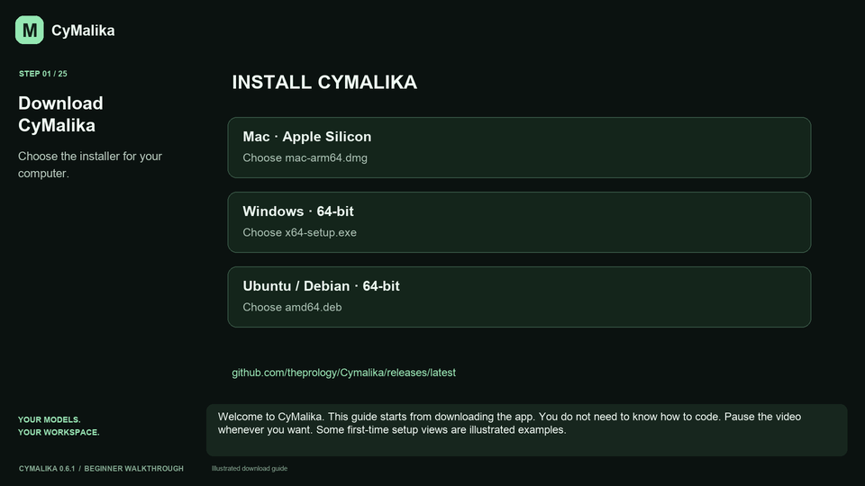
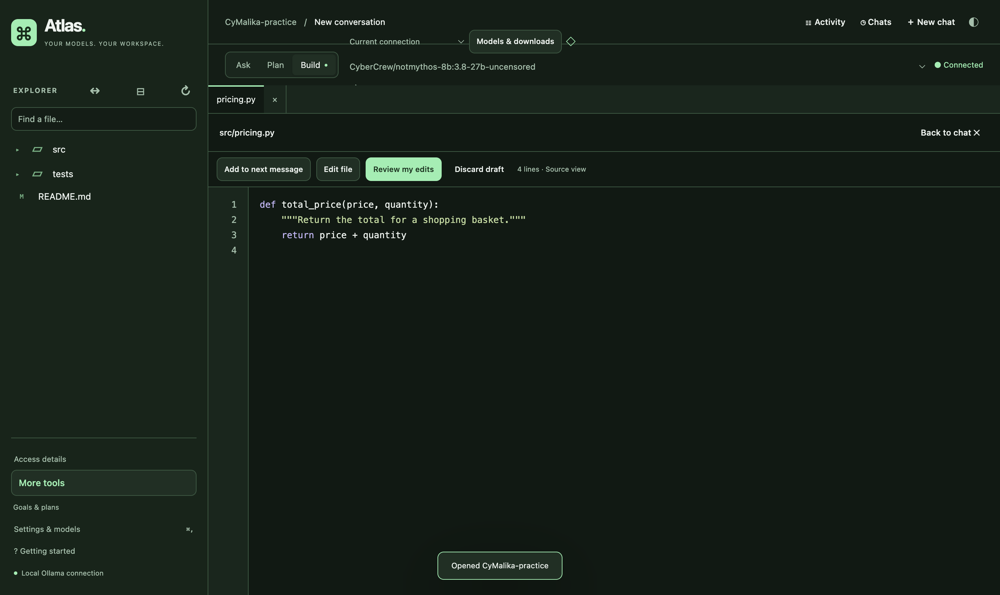
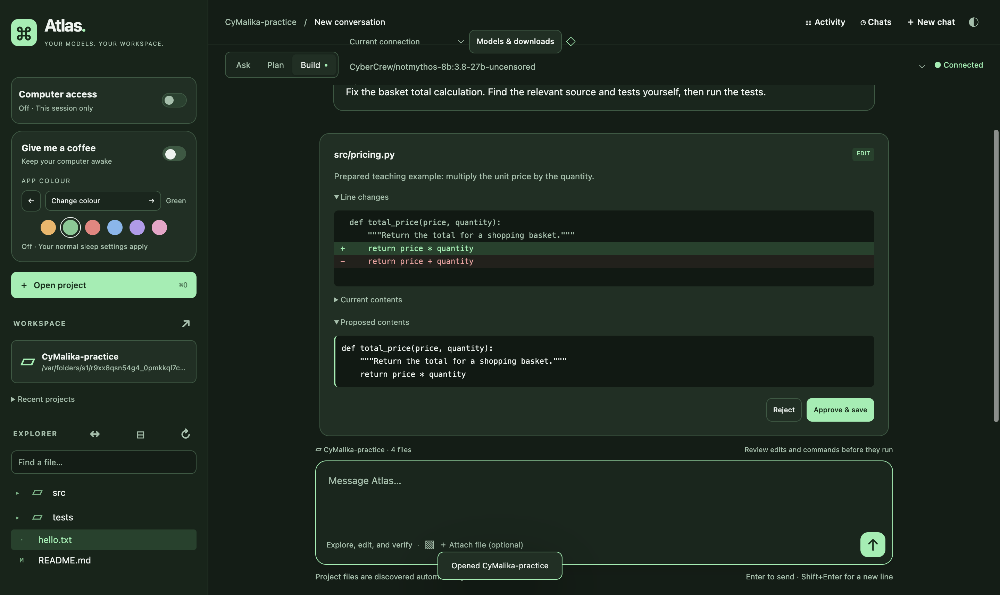

<div align="center">

# CyMalika

### Your models. Your workspace.

A free, open-source desktop coding agent for **Ollama and compatible model APIs**, on **macOS, Windows, and Linux**. Chat with your model, explore a project, review file edits, and run checks in one app.

**Set up models inside the app · Ask, Plan & Build · Project Explorer · Computer access**

[**Download the latest CyMalika**](https://github.com/theprology/Cymalika/releases/latest) · [Report a bug](https://github.com/theprology/Cymalika/issues/new) · [Read the walkthrough](docs/WALKTHROUGH.md)

[Beginner walkthrough](docs/WALKTHROUGH.md) · [Getting started](#get-started) · [Features](#a-workspace-that-does-more) · [Build](#build-from-source) · [Roadmap](docs/ROADMAP.md) · [MIT license](LICENSE)

</div>

---

CyMalika brings conversations, project files, plans, and tools into one desktop app. Open your project, choose an installed model, and describe what you want to build. CyMalika gives the model tools to find relevant files, propose edits, and request checks. You review actions before they run.

In CyMalika, **Computer access** is one session switch for app discovery, web browsing and user-folder files. Turn it on and describe a task; the model chooses the tools it needs. Review proposed actions in chat, use Stop to interrupt, and turn access off to disconnect. [How to use computer access](docs/COMPUTER_USE.md).

CyMalika itself needs no account or subscription. For local use, keep your existing Ollama/model or install the internal engine and download a chosen model inside CyMalika. Cloud APIs are another option and may charge separately. Downloads start only after you review and confirm them; CyMalika never silently switches your selected model.

## Models without leaving the app

Open **Models & downloads** to reuse your existing Ollama, install a checksum-verified local runtime, browse all Hugging Face model formats with runtime/hardware requirements, download supported Ollama/GGUF models only after confirmation, and manage your installed model shelf. Keep several models loaded when memory permits, or unload them to free RAM/VRAM. Save local and cloud API connections and switch from the chat header. API keys stay in memory.

In **Settings → Appearance**, give your assistant a name. That name appears in the sidebar and replies, independently of the model you select. See the [model library guide](docs/MODEL_LIBRARY.md). Model format, hardware, licensing and tool capabilities determine compatibility; a model host is not itself an inference runtime.

## See CyMalika in action

[](docs/DEMO.md)

[**Watch the narrated video**](https://github.com/theprology/Cymalika/releases/latest/download/CyMalika-Quickstart.mp4) · [Screenshots and step-by-step instructions](docs/DEMO.md)

CyMalika 0.6.1 interface walkthrough with narration, readable captions and a transcript. New-install states and prepared example edits are labelled illustrations; the practice file save and two-test result are real. No model/runtime download or live AI inference is claimed by the video.

| Browse your project                                           | Review a proposed change                                  |
| ------------------------------------------------------------- | --------------------------------------------------------- |
|  |  |

## What can I ask CyMalika to do?

- “Find where sign-in errors are handled and explain how it works.”
- “Plan a fix, then show me the changes before saving.”
- “Add a setting, find the relevant files, and run the project checks.”

Use your existing model. Tool use and task quality depend on that model; CyMalika does not promise the same reasoning ability as a hosted coding service.

## Get started

**New here? Start with the [picture-by-picture beginner guide](docs/WALKTHROUGH.md).** It covers downloading the correct installer, setting up a local engine/model, and creating your first file without coding.

1. Download the installer for your computer from [the latest release](https://github.com/theprology/Cymalika/releases/latest).
2. Open CyMalika → **Models & downloads**. If Ollama is already running, select your installed model. If you are starting fresh, use **Local engine → Install local engine → Start local engine**, then **Get models** to download your chosen model.
3. In **Installed models**, choose **Use this model**. Look for **Connected**.
4. Choose **Ask** and send a simple question.
5. Open a practice folder, choose **Build**, and ask it to create a small text file. Review the proposed contents, choose **Approve & save**, and open the saved file.

You do not need to install Ollama separately: CyMalika can install an internal copy. Local models need a compatible runtime: the internal Ollama engine is one option; LM Studio, llama.cpp, MLX-LM and GPU servers can be connected under Connections. Providers may charge for hosted usage.

[Watch the narrated walkthrough](docs/DEMO.md) · [Read the steps](docs/WALKTHROUGH.md) · [Printable handbook](docs/CyMalika-Beginners-Handbook.pdf) · [Optional practice project ZIP](docs/tutorial-project.zip)

You do not need VS Code or manual attachments for every file. Run **Check your model** for a small tool-use check; model capabilities and actual task results still matter.

## Install from your terminal

**Mac / Linux**

```sh
curl -fsSL https://github.com/theprology/Cymalika/releases/latest/download/install.sh | bash
```

**Windows PowerShell**

```powershell
irm https://github.com/theprology/Cymalika/releases/latest/download/install.ps1 | iex
```

The scripts download CyMalika from Releases and verify its SHA-256 checksum. They do not download models or change OS security settings. See [terminal installation](docs/TERMINAL_INSTALL.md) for supported platforms, install locations, script review, and verification-only options.

## A workspace that does more

| Capability         | What you can do                                                             |
| ------------------ | --------------------------------------------------------------------------- |
| Conversations      | Read formatted Markdown, tables, and code; copy replies or code blocks      |
| Project tools      | Find files, search source, read content, and review changes                 |
| Checkpoints        | Undo an approved save when it will not overwrite newer work                 |
| Ask / Plan / Build | Understand code, review structured plans, then implement                    |
| Goals              | Track milestones, evidence, pause/resume, and reviewed completion           |
| Resources          | Add your own instructions, references, and reusable text materials          |
| Project memory     | Keep conventions and decisions with each project                            |
| Model profiles     | Save connection and generation settings without saving API keys             |
| Streaming          | Watch replies arrive from supported providers                               |
| Browser            | Inspect and interact with websites you explicitly allow                     |
| Git                | Inspect changes, create branches, and review selected-file commits          |
| MCP                | Connect supported HTTP tools and text resources                             |
| Appearance         | Daylight, After hours, and Hacker themes; adjustable text size              |
| Computer tools     | Inspect allowed apps, approve actions, and request supported window capture |

## Platform support

| Platform                | App                                        | Status                                                                     |
| ----------------------- | ------------------------------------------ | -------------------------------------------------------------------------- |
| macOS 13+ Apple Silicon | Native Swift / WebKit app                  | Installed and tested locally                                               |
| Windows x64             | Electron `.exe` installer and portable app | Built and tested on Windows CI, including packaged startup and tool bridge |
| Linux x64               | Electron AppImage and Debian package       | Installed and started on Linux CI, with backend and bridge checks          |

The Windows and Linux versions share the interface, model adapters, and agent loop. Their backend provides coding, Git, streaming, and browser tools. **CyMalika 0.4 adds desktop tools on Windows and Linux.** The backends use Windows UI Automation and Linux AT-SPI; see [computer use](docs/COMPUTER_USE.md) and [signing](docs/SIGNING.md) for current setup and limits. Do not assume desktop automation parity between platforms. Mac downloads are Developer ID signed and Apple-notarized. Windows downloads are currently unsigned. Linux downloads include SHA-256 checksums and a linked, verified CI build. Signature and attestation status is recorded per release. Linux Wayland does not yet support pointer/key/capture sessions; use X11 for those tools.

## Bring your own model

- **Ollama:** `http://localhost:11434`
- **OpenAI-compatible endpoints:** enter the API base URL, including its prefix such as `/v1`.
- **Anthropic:** use its API endpoint and your session API key.

Native tool calls are preferred. Text actions offer a fallback for some models without native tools. Compatibility depends on the model and endpoint; connecting successfully does not guarantee reliable autonomous coding. Image support is opt-in for models that accept images.

## Your workspace, your decisions

File edits, commands, browser actions, Mac app actions, and external tool calls require review. Ask and Plan are read-only for project changes. Browser, computer, and extension access reset to off on restart.

File tools stay inside the selected project and exclude symbolic-link paths and common credential files. Commands run as your user and **are not confined to the project folder**. Review the exact command before approving it. Stop cancels pending work and requests process termination; it cannot undo actions already performed.

Chats, non-secret settings, and checkpoints stay in local application data. They can contain source code and output and are not encrypted. Session API keys and attached image bytes are excluded from saved chat state. The model endpoint you select receives the context you send. MCP endpoints and allowed websites receive their respective requests. There is no built-in analytics service or automatic updater.

See [the user guide](docs/USER_GUIDE.md) for limits and setup, and [validation](docs/VALIDATION.md) for tested paths and outstanding checks.

## Build from source

Requirements: Node.js 24+, npm, and Git. Native Mac builds additionally need Xcode command-line tools and Python 3.

```sh
npm ci
npm test
```

**Native Mac app**

```sh
./build.sh
# build/CyMalika.app
```

Set `CYMALIKA_ARCH=x86_64` to compile an Intel target; the local runtime validation covers Apple Silicon.

**Windows / Linux desktop development**

```sh
npm start
```

Build on the target operating system:

```sh
npm run dist:win
npm run dist:linux
```

Installers appear in `dist/`. GitHub Actions runs tests and produces platform artifacts. Tagged builds prepare a draft release after all configured platform jobs succeed. Only the latest verified public release is kept available for download. Older release downloads are removed after the replacement is published and verified; Git history remains available.

## Help more people find CyMalika

If CyMalika helps you, star this repository, share its link with a real example of your workflow, and report reproducible issues. Start with the [beginner walkthrough](docs/WALKTHROUGH.md) when introducing someone new. Contributions and platform testing are welcome.

## Contribute

Bug reports, accessibility improvements, platform testing, and focused pull requests are welcome. Include your operating system, CyMalika version, provider/model, reproduction steps, and sanitized logs. Never include API keys or private project contents.

Read [CONTRIBUTING.md](CONTRIBUTING.md) and [SECURITY.md](SECURITY.md). CyMalika is free to use, modify, and redistribute under the [MIT license](LICENSE). Model weights and third-party services retain their own licenses and terms.

### Coffee: keep awake

Turn on **Give me a coffee** in the sidebar to keep your whole computer awake while CyMalika is open. On Mac this matches `caffeinate -dim` (display, system idle and disk idle). Turning Coffee on briefly pops up CyMalika taking a sip, then automatically returns to your chat while keeping the computer awake. There is no separate animation screen or replay button. **Change colour** changes the whole app and cycles Amber, Green, Red, Blue, Violet and Rose; the left arrow returns to the previous colour, and the dots select a colour directly. Your colour is remembered. Switch Coffee off to restore normal idle sleep. Quitting CyMalika also releases it; closing a laptop lid or choosing Sleep still works normally.

### Project Explorer and messaging

Expand folders in **Explorer**, or search by filename/path. Drag its right edge to make file names wider. Click a file to open the source viewer; files open in tabs with line numbers and syntax colours. **Edit file** starts a draft, **Review my edits** asks you to approve the save, and **Back to chat** returns to your conversation. Switching tabs preserves drafts.

Press **Enter** to send a message, **Shift+Enter** for a new line, or **Command/Ctrl+Enter** to send.
