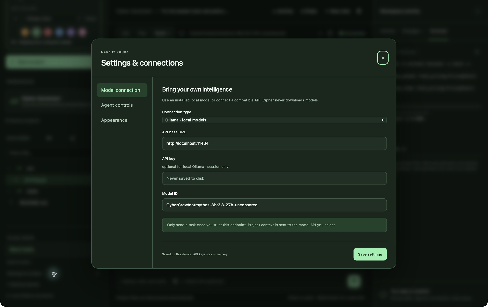
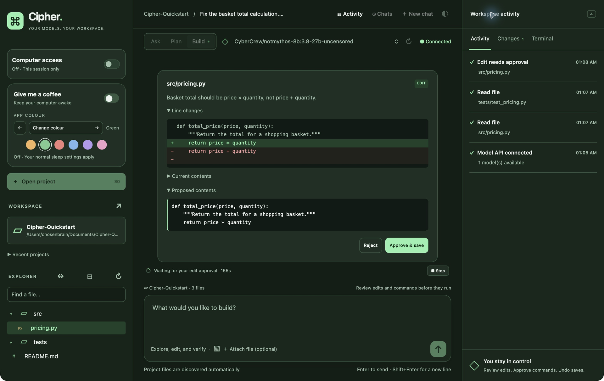
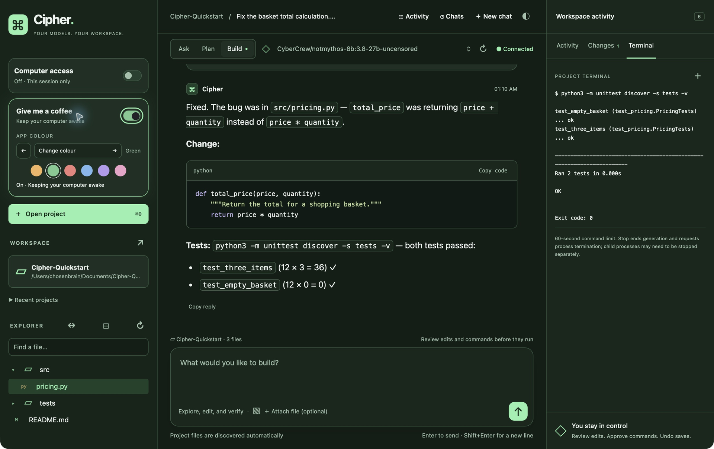

# Watch Cipher, then try it yourself

[Watch the captioned walkthrough](media/cipher-walkthrough.mp4) · [Download Cipher](https://github.com/theprology/cipher/releases/latest) · [Full beginner guide](WALKTHROUGH.md)

The video is a silent, captioned walkthrough made from real Cipher 0.5.5 macOS captures. [Read the transcript](media/TRANSCRIPT.md). Long model waits are shortened. It uses an isolated sample project and the existing local Ollama model shown in the interface. It is not a speed benchmark or a guarantee that every model completes every task. The same main controls are available on Windows and Linux; operating-system permissions differ.

Download or copy the [small practice project](tutorial-project) to follow the same exercise. It contains an intentional bug and requires Python 3. Use a copy; the screenshots show the fixed result.

## Follow along

1. Install Cipher from the latest release. Open Ollama with a model you already have, or configure a supported API in **Settings & models → Model connection**.
2. Choose your model at the top and look for **Connected**. Use **Check your model** to test a small tool exchange.
3. Click **Open project** and choose a folder containing your code. Folders and files appear in **Explorer**. Click a filename to read it in a tab.
4. Choose **Ask** to get an explanation, **Plan** to work out an approach, or **Build** to propose changes.
5. Describe the result you want. Press **Enter** to send; **Shift+Enter** inserts a new line. You do not need to attach every file.
6. Watch **Activity** as the model reads relevant files. Review each proposed change and choose **Approve & save** only when it is right.
7. Review any proposed test command before running it. Read the real output under **Terminal**. A reply saying “done” does not replace checking the result.
8. Click the changed file in Explorer to inspect the saved source. Use a checkpoint or Git if you need to undo a change.

The task shown in this walkthrough is:

> Fix the basket total calculation. Find the relevant source and tests yourself. Make the smallest fix, then run python3 -m unittest discover -s tests -v.

The sample function adds the unit price and quantity; the intended behavior multiplies them. The sample has two tests: three items and an empty basket. This small example makes the proposed change easy to review.

## Optional controls

- **Computer access** is for app, browser, and user-folder tools beyond the selected project. It is not needed for this coding example. Turn it on only when your task needs those tools, and review the proposed actions. macOS may also require system permissions.
- **Give me a coffee** keeps the computer awake while Cipher is open. A brief sip appears and automatically returns to the chat. Turn it off to restore normal idle sleep.
- **Change colour**, its back arrow, and the colour dots change the whole app palette. The theme button at the top cycles the available themes.
- **Getting started** reopens the built-in tour whenever you need it.

## Screenshots

### Connect an existing model

### Start a conversation in your project

### Browse the source without leaving Cipher

### Review before saving

### Check actual results

No private project, saved personal conversation, API key, or account credential is included in these captures.
