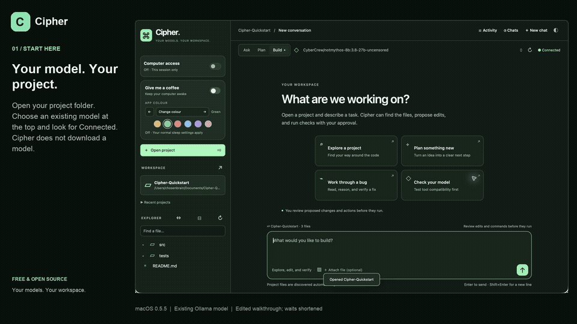
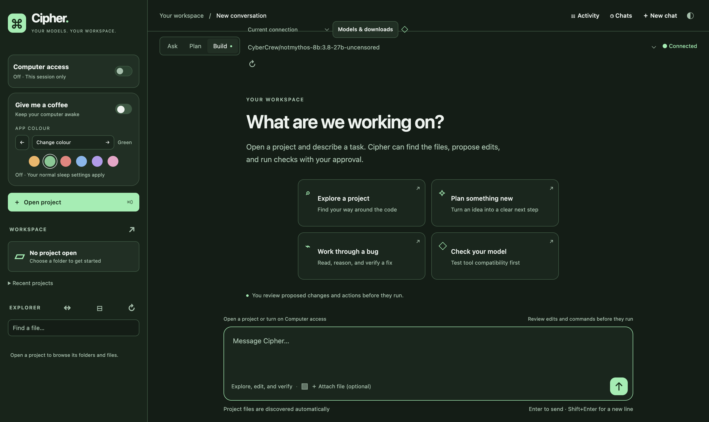
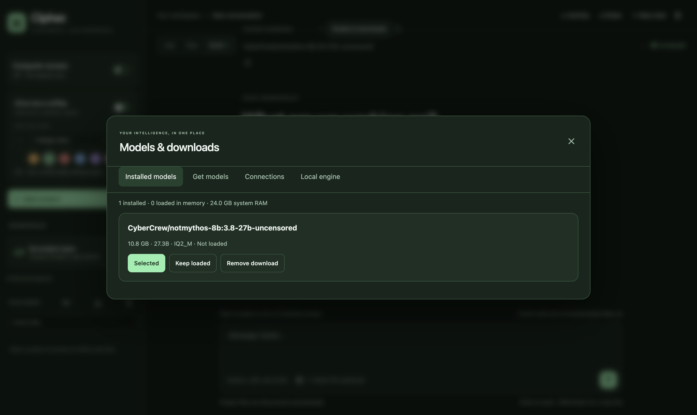
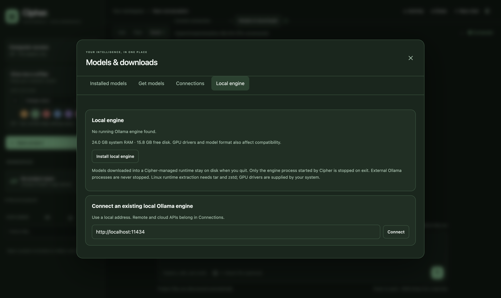
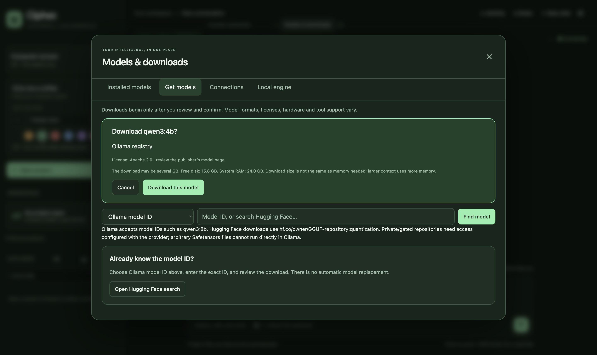
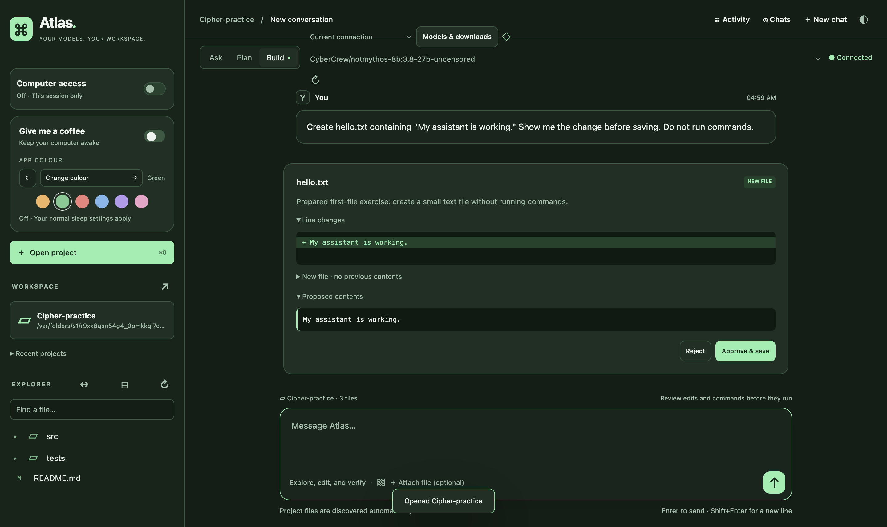
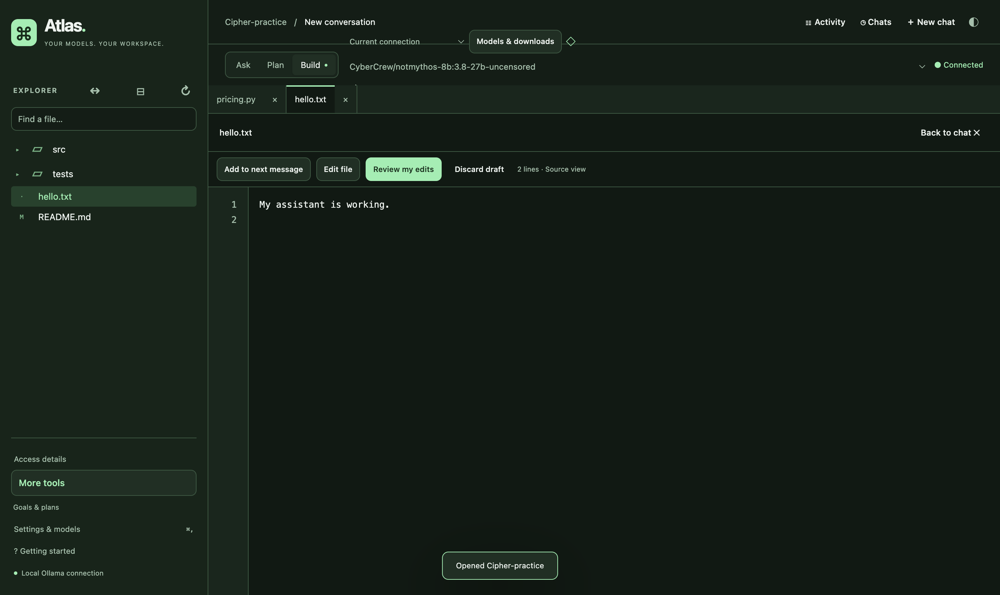
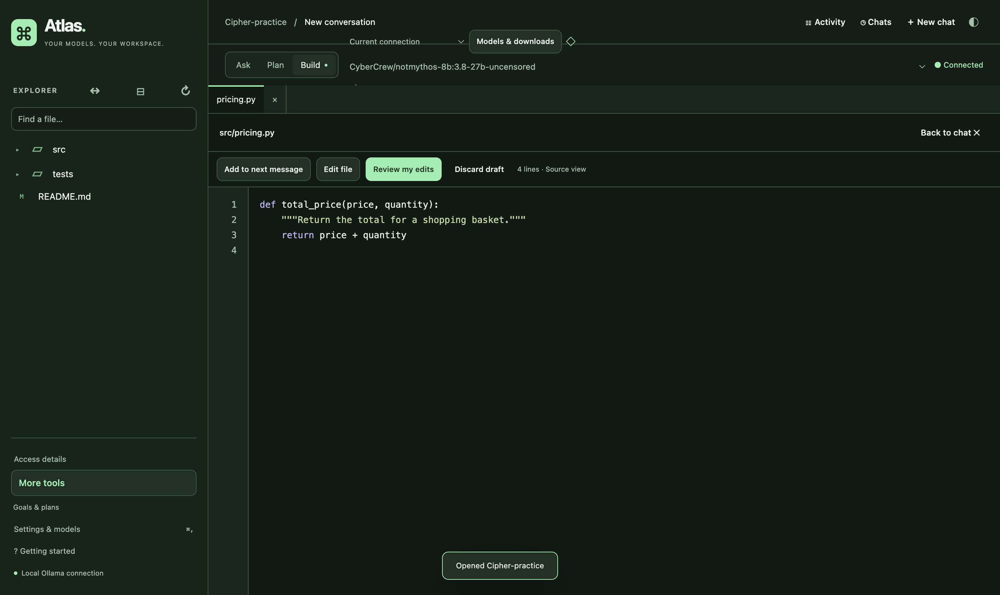
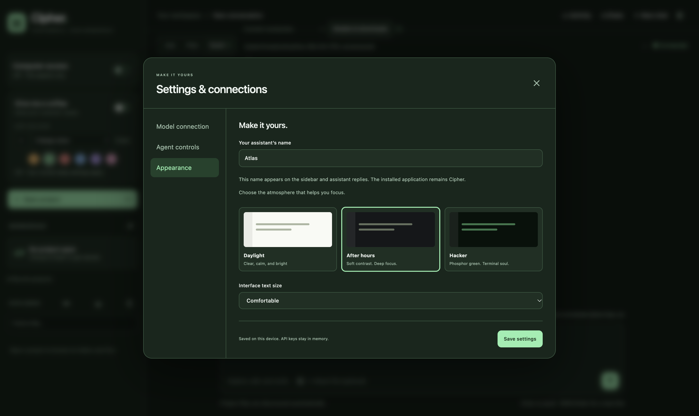
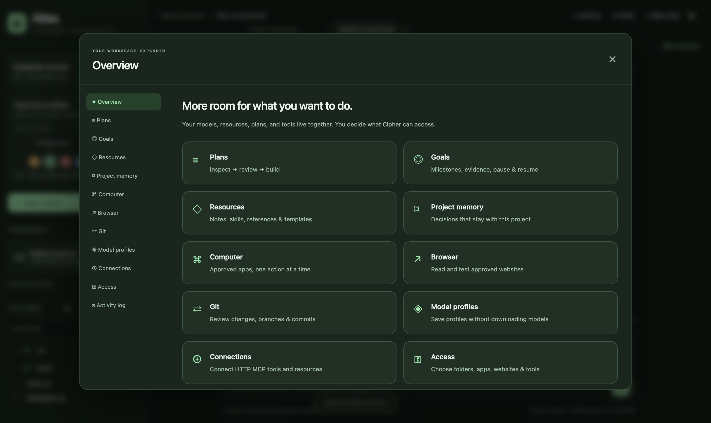

# Start with Cipher: watch, then follow along

[**Watch or download the narrated video**](https://github.com/theprology/cipher/releases/latest/download/Cipher-Quickstart.mp4) · [**Read the beginner steps**](WALKTHROUGH.md) · [**Download the handbook**](Cipher-Beginners-Handbook.pdf)

The video has spoken narration and readable captions. You can pause whenever you need. [Read the full transcript](media/TRANSCRIPT.md), [download subtitles](media/cipher-walkthrough.srt), or [open the repository copy of the video](media/cipher-walkthrough.mp4).

## Choose where to start

- **I have not installed Cipher:** start at [step 1: download the right file](WALKTHROUGH.md#1-download-the-right-file).
- **I already have Ollama:** go to [step 3A](WALKTHROUGH.md#3a-i-already-have-ollama-and-a-model). Keep your existing installation.
- **I am starting from scratch:** go to [step 3B](WALKTHROUGH.md#3b-i-am-starting-from-scratch). Install the internal engine first, then download and select a model.
- **I have an API key instead:** go to [step 3C](WALKTHROUGH.md#3c-i-want-a-cloud-api-instead).
- **I want my first simple success:** follow [the hello.txt exercise](WALKTHROUGH.md#5-make-your-first-file-without-coding). It needs no Python, terminal or programming knowledge.

**The Ollama explanation in one sentence:** local models need an engine; Cipher can install an internal Ollama engine, so you do not need to install Ollama separately. If you already have Ollama, keep using it.

## What the recording shows

This is a Cipher **0.6.0** interface walkthrough captured from an isolated demonstration workspace. It includes illustrated first-install views and prepared teaching questions/edits. It is not a live AI inference recording, speed benchmark, or proof of a complete fresh-machine installation. The model shown on the existing-installation screens was already installed; `qwen3:4b` is only an example download ID and was not downloaded for the recording.

The text-file save, practice source edit and two-test command result are real operations in a disposable practice folder. Captions identify prepared examples and actual results. No personal project, account credential, API key, system permission grant, runtime download or model download is included. Narration uses the installed macOS Samantha synthetic voice. Screens show the shared desktop interface; OS installation and permissions differ on Mac, Windows and Linux.

## Screenshots: setup to first result

### 1. Open Cipher

### 2. Reuse your existing model

### 3. Or start with an internal engine

### 4. Choose and review a model download

### 5. Create a tiny file without coding

### 6. Open the saved file and check it

### 7. Explore project files

### 8. Review a code change

### 9. Read actual test results

### 10. Choose your assistant’s name

### 11. Discover the extra tools

## Optional coding exercise

[Download the practice project ZIP](tutorial-project.zip). Extract it, then choose its **Cipher-practice** folder with Open project. It has an intentional basket-total bug. Python 3 is needed only to run this exercise’s tests.

Send this request in Build:

> Fix the basket total calculation. Find the relevant source and tests yourself. Make the smallest fix, then run the existing tests. Show me proposed edits and commands before executing them.

Review the proposed file and command. Check the real saved file and Terminal output afterward. The first hello.txt exercise is a simpler option if you do not have Python.

## Everything in one download

The [getting-started bundle](https://github.com/theprology/cipher/releases/latest/download/Cipher-Getting-Started.zip) contains the handbook, narrated video, transcript, subtitles, screenshots and optional practice-project ZIP. Extract it and open **START-HERE.html**. Internet is still needed for installing the runtime/model, model search, cloud APIs and browsing websites.
