# Start here: download Cipher and make it work

You do not need to know how to code to follow this guide. Start at step 1. Stop at any point and come back later.

[Watch the narrated video](media/cipher-walkthrough.mp4) · [See the animated preview](DEMO.md) · [Download the printable handbook](Cipher-Beginners-Handbook.pdf)

## 1. Download the right file

Open [Cipher’s latest release](https://github.com/theprology/cipher/releases/latest). Scroll to **Assets**. Choose **one** file for your computer. You do not need a GitHub account to download a public release.

| Your computer                         | Choose this file                       |
| ------------------------------------- | -------------------------------------- |
| Mac with an Apple M-series chip       | The file ending in **mac-arm64.dmg**   |
| Windows 64-bit                        | The file ending in **x64-setup.exe**   |
| Ubuntu or Debian Linux 64-bit         | The file ending in **amd64.deb**       |
| Another compatible Linux distribution | The file ending in **x86_64.AppImage** |

**Do not choose Source code** if you just want to use the app. The portable Windows file is an optional alternative to the installer.

**Mac:** open the downloaded DMG, drag **Cipher** to **Applications**, then open Cipher from Applications. The published Mac app is for Apple Silicon; Intel Mac users need a compatible build. Cipher can open on macOS 13, but the current in-app local engine needs macOS 14 or newer.

**Windows:** open the setup EXE and follow its installer. Then open Cipher from Start. The Windows packages are currently unsigned; review the download and any system notice before deciding whether to proceed. Ask for help if you are unsure about a warning.

**Ubuntu/Debian:** open the DEB with your software installer, choose Install, and open Cipher from your app menu. Other Linux users can use the AppImage with their distribution’s normal launch instructions. Local engine extraction requires tar and zstd; the DEB declares zstd as a dependency.

**You are ready for step 2 when:** the Cipher window opens. You do not need VS Code.

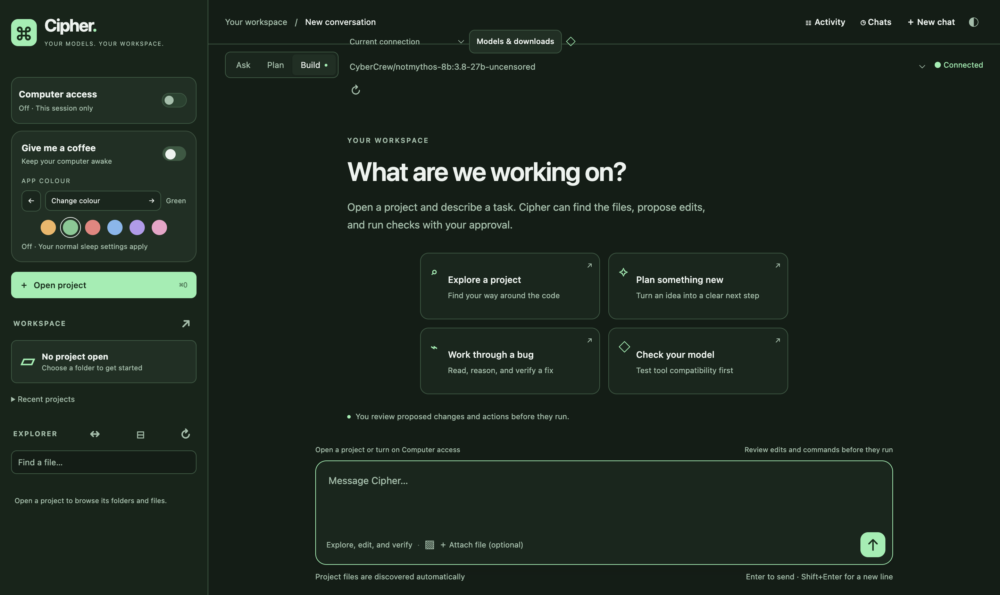

## 2. Understand Cipher, Ollama and a model

Think of this as three parts:

- **Cipher is your workspace:** the chat, files, buttons and tools you use.
- **Ollama is the local engine:** the program that runs an AI model on your computer.
- **The model is the intelligence:** the downloaded model that produces replies and chooses actions.

**Local models still need an engine.** “You do not need to install Ollama separately” means Cipher can install an internal copy for you. It does not mean local models run without an engine.

Choose the next section that describes you:

- **I already have Ollama and a model:** follow step 3A.
- **I am starting from scratch:** follow step 3B.
- **I want to use a cloud API:** follow step 3C. A cloud API does not need local Ollama.

## 3A. I already have Ollama and a model

1. Leave your existing Ollama installed. Open it if it is not running, or use **Local engine → Start local engine** inside Cipher.
2. In Cipher, click **Models & downloads** beside the model selector at the top.
3. Open **Installed models**.
4. Find your model and click **Use this model**. If it already says **Selected**, you are ready.
5. Close the model library. Look for **Connected** and your model’s name near the top.
6. Go to step 4. You do not need another engine or another model download.

**If the list is empty or unavailable:** open **Local engine**. For a normal existing Ollama installation, the local address is `http://localhost:11434`. Click **Connect**, then return to Installed models. Leave the API key blank for a normal local setup.

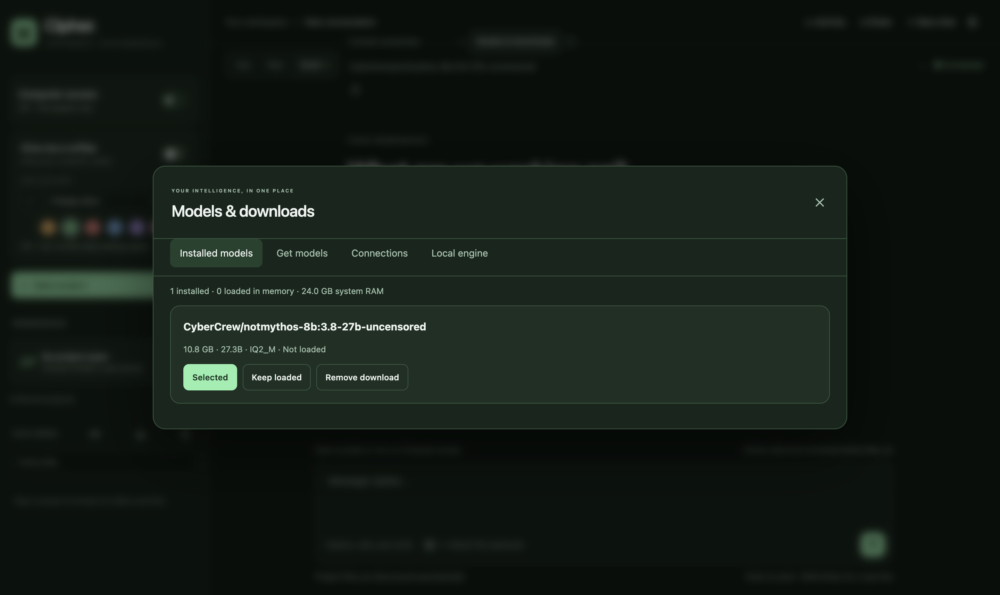

## 3B. I am starting from scratch

You can do these steps inside Cipher. You need internet access for the initial downloads and enough free disk space.

1. Open **Models & downloads → Local engine**.
2. Click **Install local engine**.
3. Review the download. Click **Install this engine** if you want it.
4. Wait until installation finishes. **This installs the engine, not an AI model.**
5. Click **Start local engine**. A newly installed internal engine is managed by Cipher.
6. Open **Get models**. Leave the source set to **Ollama model ID**.
7. Enter a model ID and click **Find model**. If you want a concrete example, copy `qwen3:4b`. This is an example, not a guarantee it will fit or work well on your computer. The publisher currently lists a roughly 2.5 GB download; running it and using larger conversations needs additional memory. See the [model page](https://ollama.com/library/qwen3:4b).
8. Review the model name, license and available space. Click **Download this model** only when you want that download.
9. Wait for the progress card to say it is complete. Keep the app open. A large download may take a while.
10. Open **Installed models** and click **Use this model**.
11. Close the library. Look for **Connected** and the model name.

**You are ready when:** the model is installed, selected and connected. If only the engine is installed, finish steps 6–10.

You can cancel a model download in its progress card. To resume cached model layers, download the same model ID again. A cancelled engine package starts again from the beginning.

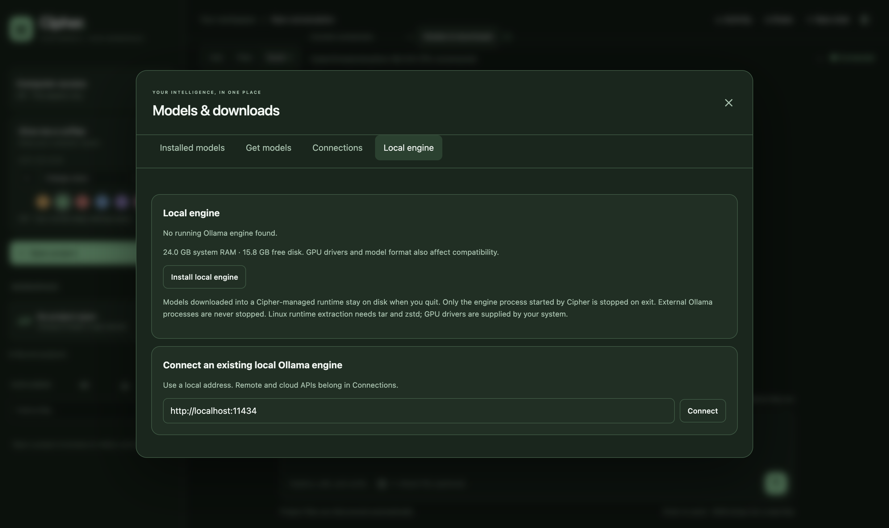

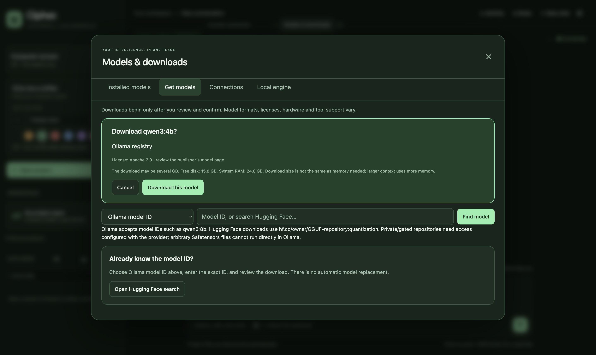

These pictures show the setup controls. The demonstration does not actually download the example model or reinstall the engine.

## 3C. I want a cloud API instead

This option uses a service on the internet. Your computer does not need to run the model locally, but the provider may charge you.

1. Open **Settings & models → Model connection**.
2. Choose the provider’s supported connection type.
3. Enter the provider’s API address, your API key and the model ID from that provider.
4. Click **Save settings** and check the connection.

An **API key** is a private access code from the provider. Enter it only in the API key field, never in chat. Cipher keeps it only for the current app session. You may need to enter it again after quitting. Remote services receive the task and context you send them.

If you do not already have a provider account and API details, the local setup in step 3B is the simpler place to begin. A chat-service subscription does not automatically provide an API key.

## 4. Ask your first question

1. Choose **Ask** near the top.
2. Click the message box at the bottom.
3. Type: **Hello. Explain what you can help me do, using simple words. Do not use tools or change anything.**
4. Press **Enter** or click the arrow to send. **Shift+Enter** adds a new line.
5. Wait for a reply. The first reply can be slower while a local model loads into memory.

**Success looks like:** a readable reply in the conversation. If the model replies, your basic connection works. Coding and computer control depend on additional model capabilities; run **Check your model** for a small tool-use check.

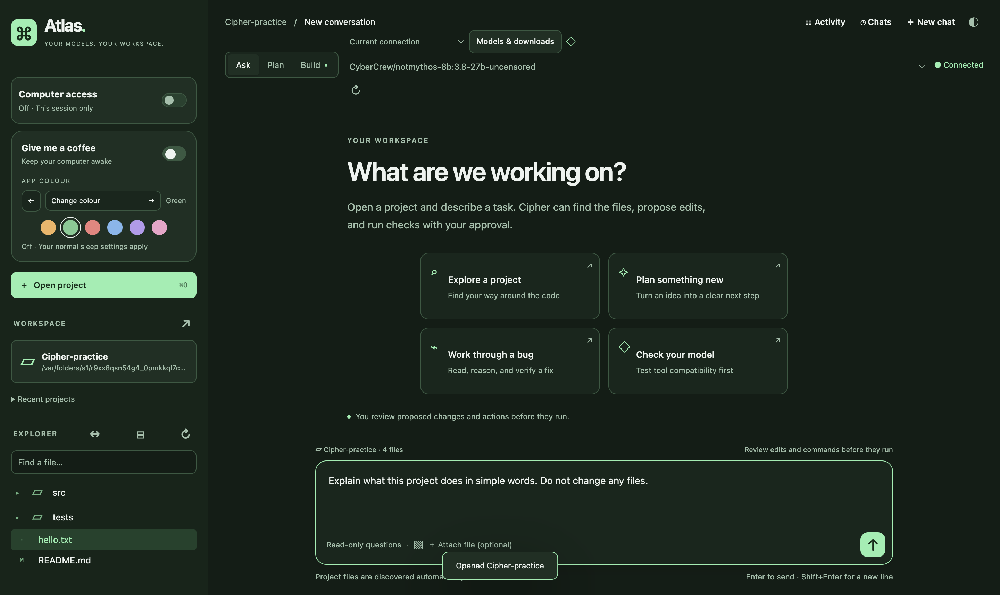

## 5. Make your first file, without coding

Use a new practice folder so you can learn without touching important work.

1. Use Finder on Mac, File Explorer on Windows, or your Linux file manager to create a folder called **Cipher practice** in Documents.
2. In Cipher, click **Open project**, choose that folder and click Open. A project is just a folder of files.
3. Choose **Build**.
4. Send: **Create a file called hello.txt containing “My assistant is working.” Show me the change before saving. Do not run commands.**
5. When a proposal appears, check that the filename is **hello.txt** and read its contents.
6. Click **Approve & save** to create it. Click Reject if it is wrong.
7. Click **hello.txt** in the left Explorer to read the saved file.

**Success looks like:** the file exists in your practice folder and contains the text you requested. A reply saying “done” is not enough; check the saved file.

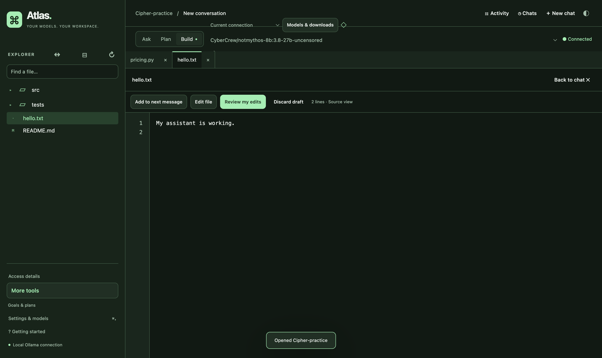

If the model only talks about creating the file, ask it to use the file tool. If it still cannot, use **Check your model** and read the actual error. Models differ in tool-use ability.

## 6. Open an existing project and view files

Click **Open project** and select the folder for your website, app or other work. Your files appear in **Explorer** on the left. Expand folders and click a filename to open it in a source tab.

You do not need to attach every file. The model can list, search and read relevant files inside the selected project. **Add to next message** is optional when you want to point to one particular file.

The optional [practice project ZIP](tutorial-project.zip) contains a tiny Python exercise with an intentional bug. Download it, extract it, and open the extracted **Cipher-practice** folder. Python 3 is needed for its tests; it is not needed for the hello.txt exercise above.

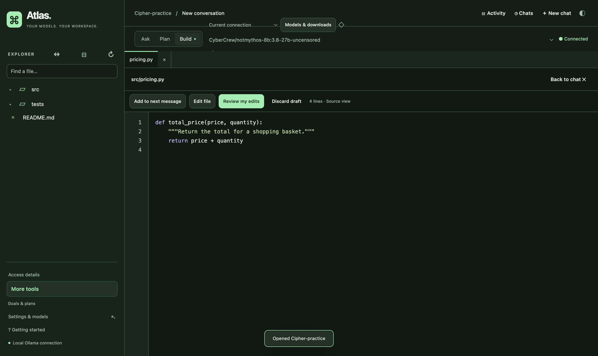

## 7. Choose Ask, Plan or Build

| Mode      | Use it when you want                                    |
| --------- | ------------------------------------------------------- |
| **Ask**   | An explanation or read-only investigation               |
| **Plan**  | A proposed approach before any change                   |
| **Build** | The model to propose edits and other actions for review |

A useful Ask request is: **Read this project and explain what it does. Do not change files.**

A useful Plan request is: **Plan the smallest fix for this problem. Find the relevant files and explain how we will check the result.**

A useful Build request is: **Find the relevant files, make the smallest fix and run the existing checks. Preserve unrelated work.**

Approving a plan does not approve every future edit or command. You review those separately.

## 8. Review a proposed change

Look for the filename, the explanation and **Line changes**. Green lines are added; red lines are removed. Expand Current contents or Proposed contents if you need more detail.

- **Approve & save** writes the proposed file.
- **Reject** leaves the proposal unapplied.
- **Saved · checkpoint created** means that save returned successfully.
- **Undo this save** can restore the earlier contents if the file has not changed again.

You can also edit a file yourself: open it in Explorer, choose Edit file, make your changes, and choose **Review my edits**. The save still needs your approval.

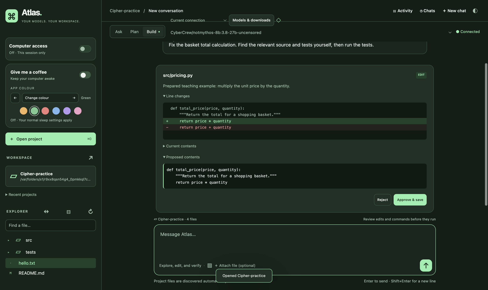

## 9. Check the result

After a code change, ask the model to run the project’s existing checks. When it requests a command, read the command and reason before choosing **Run command**. If you do not understand it, reject it and ask for an explanation.

Open **Activity → Terminal** to read the actual output. For the optional practice project, the guide’s real test run ends with **Ran 2 tests** and **OK**. Python 3 must be installed to repeat that exercise.

On Mac/Linux its command is `python3 -m unittest discover -s tests -v`. On Windows, ask the model to use `py -3 -m unittest discover -s tests -v` if python3 is unavailable. Check your own project normally too; passing a small test is not proof that everything works.

**Stop** cancels pending work and requests command termination. It does not undo actions that already happened. Checkpoints and Git/backups help you recover changes.

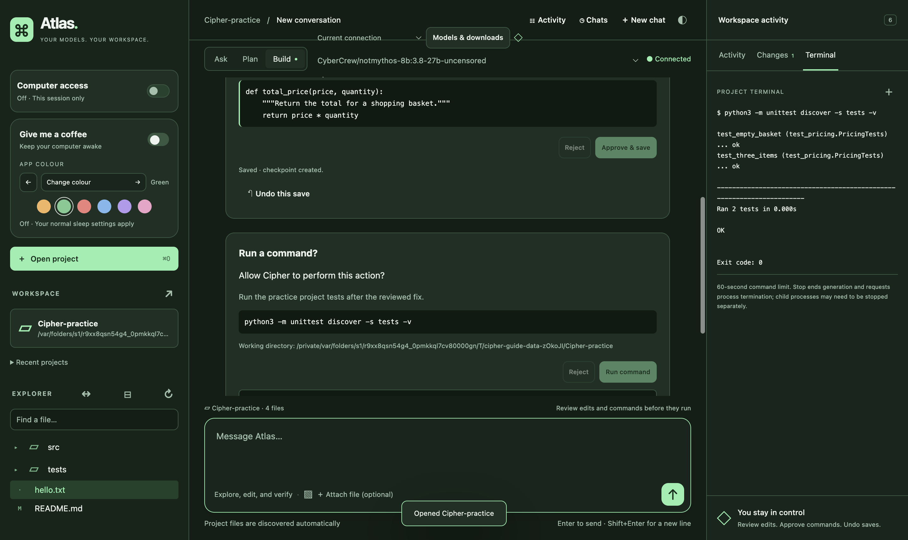

## 10. Let the model use apps, websites and ordinary files

Computer access is optional. Leave it off for simple questions and project-only tasks.

1. Turn on **Computer access** in the left sidebar.
2. Describe one clear task, such as: **Open example.com, read it and save a short summary in my Documents folder. Ask me before saving.**
3. Review the proposed website, app or file action before approving it.
4. Ask the model to inspect the result and read saved files back.
5. Turn access off when you are finished.

On Mac, app control needs Accessibility permission; screenshots also need Screen Recording. Grant them through **System Settings → Privacy & Security** for Cipher if your task needs them. The app cannot give itself those permissions. Protected authentication and OS prompts may still need your direct input. Windows and Linux have different system boundaries; see [computer access](COMPUTER_USE.md).

A password request opens a separate secure entry window. Type a password there, never in chat. Permission requests name the specific action for your approval. Computer access does not mean every app or website can be controlled perfectly.

## 11. Make it yours

**Name:** open **Settings & models → Appearance → Your assistant’s name**, enter a name and save. Replies and the sidebar use it. The installed application remains Cipher.

**Theme:** choose Daylight, After hours or Hacker in Appearance. You can also cycle themes with the small theme button at the top.

**Colour:** use **Change colour**, the back arrow or a colour dot in the left sidebar. This changes the whole app palette.

**Coffee:** turn on **Give me a coffee** to keep your computer awake while Cipher is open. Coffee and water briefly swirl across the app, say “Thanks man”, then return to chat. Keep-awake remains on. Turn it off to restore normal idle sleep. Closing the lid or choosing Sleep is still your operating system’s decision.

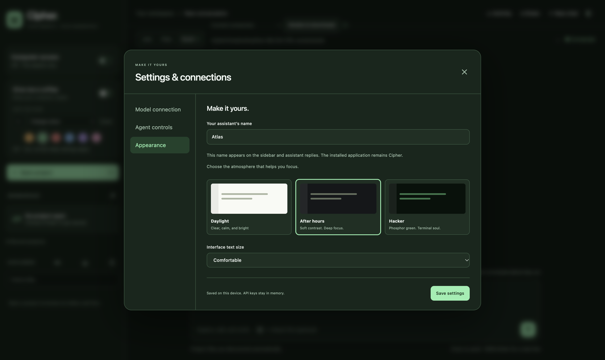

## 12. Use more than one model

Open **Models & downloads → Installed models** to choose a different downloaded model. **Keep loaded** requests that it stay in memory; **Unload from memory** frees that memory without deleting the download. Larger models and longer conversations use more RAM/VRAM. The engine may unload models when memory is insufficient.

**Connections** saves named local/cloud connection settings. Save the current connection there, configure another in Settings, then save that one too. Choose a saved connection from the top of chat. Your assistant name and appearance are preserved. API keys remain session-only.

**Remove download** asks you to type the exact model ID before deletion. Removing a saved connection only removes its preset, not the model files.

For Hugging Face, choose **Hugging Face · public GGUF** under Get models. Search, read a model card, and choose a quantization that repository provides. GGUF is a model file format; the other format types on Hugging Face do not all run in Ollama. Gated/private models need the provider’s account access. See the [model library guide](MODEL_LIBRARY.md).

## 13. Explore the extra tools when you need them

Click **More tools**. You do not need to configure everything on day one.

- **Plans:** organise a change into proposed steps and checks.
- **Goals:** track a bigger outcome using milestones and evidence.
- **Resources:** add notes, references, templates and instructions the model can use. Enable only material you want it to receive.
- **Project memory:** save useful conventions or decisions for that project.
- **Git:** inspect changes and review a branch or selected-file commit. Git must be installed.
- **Connections / MCP:** connect supported external tool services you trust. This is different from the model connection presets in Models & downloads.
- **Activity log and Chats:** inspect activity, return to a conversation or export it.

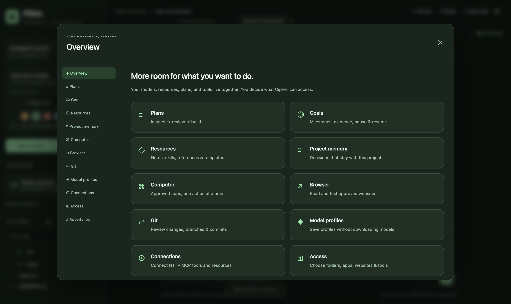

## 14. If something goes wrong

| What happened                                         | What to try                                                                                                                                                     |
| ----------------------------------------------------- | --------------------------------------------------------------------------------------------------------------------------------------------------------------- |
| **Connection unavailable**                            | Open Local engine. Start the internal engine, or open your existing Ollama and reconnect. Select an installed model.                                            |
| **Engine installed, but no reply**                    | Download a model, then choose Use this model. Installing the engine alone is not enough.                                                                        |
| **Download paused or failed**                         | Check your internet and free disk space. Read the progress card error. Retry the same model ID to reuse cached model layers.                                    |
| **Local engine does not start**                       | Check OS compatibility. Current managed Ollama needs macOS 14+. Linux extraction needs tar/zstd. A cloud API is another option.                                 |
| **Very slow, or a memory error**                      | Let the first load finish. Unload unused models, close memory-heavy apps, or choose a smaller model/context. More RAM does not remove every GPU or model limit. |
| **The model describes an action, but does not do it** | Use Build for changes. Read Activity and run Check your model. Do not treat a promise as a completed action.                                                    |
| **An approval seems confusing**                       | Choose Reject, then ask for a plain-language explanation.                                                                                                       |
| **A command fails**                                   | Read its actual output in Terminal and ask the model to explain that error.                                                                                     |
| **An app cannot be controlled**                       | Check Computer access and OS permissions. Some protected or inaccessible controls need you directly.                                                            |
| **I want to stop**                                    | Click Stop. Inspect what already happened before trying again.                                                                                                  |
| **I am lost**                                         | Open Getting started near the bottom-left to replay the in-app tour.                                                                                            |

## 15. Costs, privacy and offline use

Cipher is free and open source. Local models use your computer’s disk, RAM/VRAM and power. Cloud API providers may charge separately. Model licenses can have their own conditions.

After the runtime and model are downloaded, local chat and local project work can work offline. Downloads, model search, web browsing, external tools and cloud APIs still need the internet.

The model you choose receives your messages and the context Cipher sends for the task. With a cloud API, that means sending it to that provider. Do not put passwords, private keys or payment information in chat.

**Your first successful milestone:** you received a reply, approved a small file creation, and opened the saved file to verify it. You can learn the advanced tools afterward.
